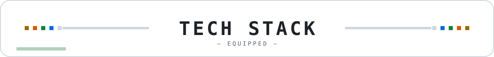
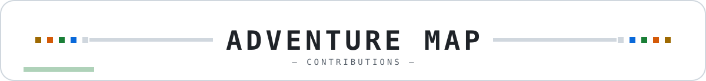
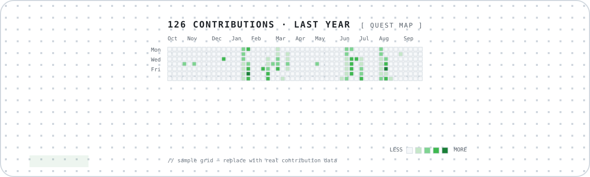
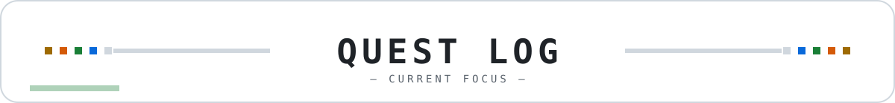
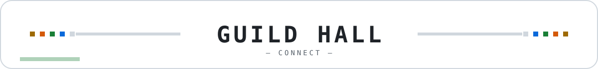

<!-- 个人主页 README V0.3.2｜像素 RPG 角色卡风格（浅色）｜个人信息与项目均为占位，请自行替换 [方括号] 内容 -->

  

  
  

    
    <strong>[One-line intro: e.g. I turn AI methods into reusable Skills, courses, and working products.]</strong>
  

  

    <a href="README.md">English</a> · <a href="README.zh-CN.md">简体中文</a>
  

  

    🏠 <a href="https://lcnf1nf2xo4j.doubao.link/app/app_17gceh40g9k"><strong>个人主页 / Personal Homepage</strong></a>
  

---

  

  <code>[Tag 1]</code>
  <code>[Tag 2]</code>
  <code>[Tag 3]</code>
  <code>[Tag 4]</code>

---

  

  

---

  

<table>
<tr>
<td valign="top" width="50%">
#### 💼 What I Do
- **[Work item 1]** — [description]
- **[Work item 2]** — [description]
- **[Work item 3]** — [description]
- **[Work item 4]** — [description]
> ✍️ [Read my articles →]([your article link])
</td>
<td valign="top" width="50%">
#### 💻 Selected Open Source
- 🧰 **[Project 1]** — [description]
- 🎬 **[Project 2]** — [description]
- 🪞 **[Project 3]** — [description]
- 🍭 **[Project 4]** — [description]
> 🗂️ [Explore all repositories →](https://github.com/hyejeongwong-max?tab=repositories)
</td>
</tr>
</table>

---

  

  <strong>[Your motto: e.g. Make it clear. Make it useful. Make it real.]</strong>

