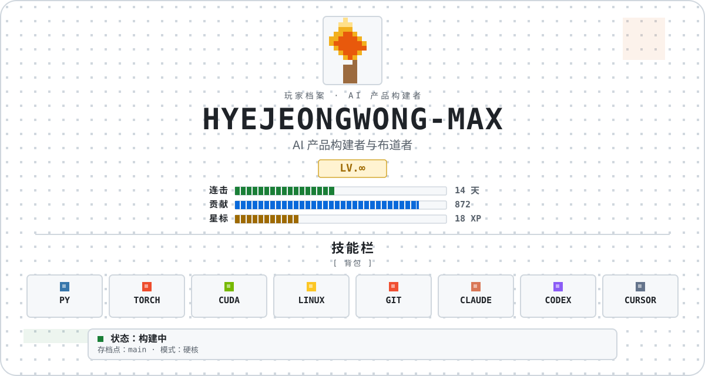
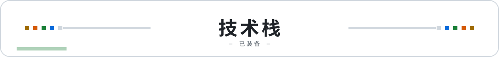
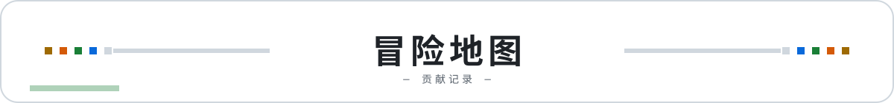
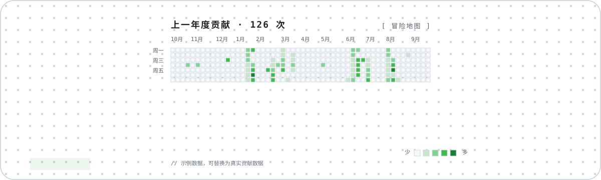
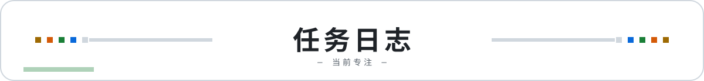
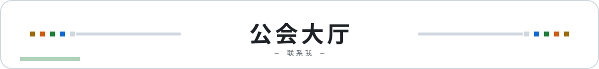

<!-- 个人主页 README V0.3.3｜像素 RPG 角色卡风格（浅色） -->

  

  
  

    
    <em>把 AI 方法做成可复用的 Skill、课程和真正能用的产品。</em>
  

  

    <a href="README.md">English</a> · <a href="README.zh-CN.md">简体中文</a>
  

 

  

  <code>[标签1]</code>&nbsp;&nbsp;<code>[标签2]</code>&nbsp;&nbsp;<code>[标签3]</code>&nbsp;&nbsp;<code>[标签4]</code>

 

  

  

 

  

<table>
<tr>
<td width="50%" valign="top">

### 💼 我在做什么
- **[工作项1]** — [描述]
- **[工作项2]** — [描述]
- **[工作项3]** — [描述]
- **[工作项4]** — [描述]

> ✍️ **[查看我的文章 →]([你的文章链接])**
</td>
<td width="50%" valign="top">

### 💻 代表开源项目
- 🧰 **[项目一]** — [项目简介]
- 🎬 **[项目二]** — [项目简介]
- 🪞 **[项目三]** — [项目简介]
- 🍭 **[项目四]** — [项目简介]

> 🗂️ **[查看全部仓库 →](https://github.com/hyejeongwong-max?tab=repositories)**
</td>
</tr>
</table>

 

  

  
<em>先讲明白，再做有用，最后真正落地。</em>

  

    <a href="mailto:your-email@example.com">📧 Email</a> &nbsp;·&nbsp;
    <a href="https://github.com/hyejeongwong-max">🐙 GitHub</a> &nbsp;·&nbsp;
    <a href="[你的社交/即刻主页链接]">💬 即刻 / X</a>
  

